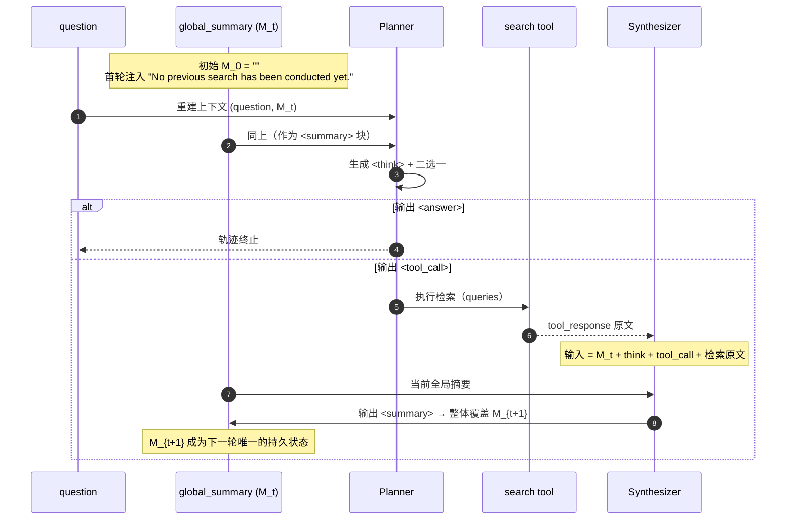

# IterSynth 调研报告

**双角色 (Planner / Synthesizer) deep search 机制及其对 RAGFlow agentic_rag 的启发**

| | |
|---|---|
| 日期 | 2026-10-07 |
| 范围 | IterSynth 工作过程（双角色 / 提示词 / 共享状态 / 上下文重建）+ 对 RAGFlow 的借鉴启发 |
| 深度 | 机制说明配行号索引，关键处贴少量代码 |
| 代码基线 | IterSynth: `/home/zhichyu/github.com/Tencent/IterSynth`<br>RAGFlow: `/home/zhichyu/github.com/infiniflow/ragflow`（**全文 RAGFlow 行号均基于此检出**） |

> **代码基线说明**：RAGFlow 侧行号基于 `/home/zhichyu/github.com/infiniflow/ragflow`。已逐文件核实：其 `internal/agentic_rag/` 与 `conf/agentic_rag.yaml` 同 `/home/zhichyu/github.com/infiniflow/ragflow2`（本文件所在位置）**内容一致**，因此报告行号**在两个检出下均可直接对照**（唯一差异见[附录 B](#附录-b未验证项) 第 2 条）。

> 本报告为内部技术调研笔记，不属于任一仓库的正式文档内容。

---

## 摘要

IterSynth 把长程 deep search 从「一个 ReAct 上下文兼顾检索、推理、聚合、作答」重构为**两个角色在一个共享策略上的交替循环**：Planner 决定下一步搜什么，Synthesizer 把新证据并入一个持续演化的全局摘要 `M_t`。真正值得借鉴的不是"双角色"这个形式，而是它由此换来的两条性质：

1. **有界上下文** —— 每轮的活动上下文由 `(question, M_t)` 重建，与历史轮数无关；
2. **状态可评分** —— 状态重写本身成为一个独立的、可被 rubric 逐轮打分的角色行为。

RAGFlow 的 `internal/agentic_rag` 其实已经长出了同构的两个要素：**Candidate Matrix + Reasoning Chain**（等价于 `M_t`）和 **search ledger**（append-only 事实账本）。差别在于：它的状态重写仍**被困在同一个 120 轮 ReAct 上下文里**，且压缩只发生在 **request 边界**。RAGFlow 自己的代码注释里留下了多处"被长历史反噬"的实证，本报告在第 5 节给出 6 条可操作的改造方向。

---

## 目录

- [1. IterSynth 工作机制](#1-itersynth-工作机制)
  - [1.1 范式定位](#11-范式定位)
  - [1.2 单轮时序](#12-单轮时序)
  - [1.3 三份提示词模板](#13-三份提示词模板)
  - [1.4 上下文重建](#14-上下文重建)
  - [1.5 角色靠什么区分](#15-角色靠什么区分)
- [2. 共享状态：`global_summary`](#2-共享状态global_summary)
  - [2.1 五段结构](#21-五段结构)
  - [2.2 生命周期](#22-生命周期)
  - [2.3 它不含什么](#23-它不含什么)
  - [2.4 两个边界行为](#24-两个边界行为)
  - [2.5 为什么不是工具、不是 session](#25-为什么不是工具不是-session)
- [3. 训练侧：单轮样本与双角色奖励](#3-训练侧单轮样本与双角色奖励)
- [4. 与 RAGFlow agentic_rag 的机制对照](#4-与-ragflow-agentic_rag-的机制对照)
- [5. 对 RAGFlow 的 6 条启发](#5-对-ragflow-的-6-条启发)
- [6. 注意事项与风险](#6-注意事项与风险)
- [附录 A：行号索引](#附录-a行号索引)
- [附录 B：未验证项](#附录-b未验证项)

---

## 1. IterSynth 工作机制

### 1.1 范式定位

IterSynth 是一个 **role-decoupled、summary-based** 的 long-horizon deep search 范式。它不使用多个模型，而是让**单一共享 LLM 策略**在循环中交替扮演两个角色：

- **Planner** —— 基于当前研究状态决定*下一步搜哪里*，或直接给出最终答案；
- **Synthesizer** —— 把新检索到的证据整合进一个**持续存在的全局摘要**。

训练侧配套 **RDPO**（Role-Decoupled Policy Optimization）：每轮收到一个复合奖励（全局广播的终局结果信号 + 该角色的 rubric 分），优势在 **Planner 池**与 **Synthesizer 池**内**分别独立归一化**，避免稠密的 Synthesizer 信号与稀疏的 Planner 信号互相污染基线。

本仓库的实现形态是 [verl](https://github.com/volcengine/verl)（~`v0.5.0.dev`）之上的 overlay 补丁，双角色 rollout 的**全部逻辑集中在一个文件**：`patch/verl/workers/rollout/sglang_rollout/sglang_rollout_lf.py`（5702 行）。

关键配置：搜索轮数上限 `max_search_rounds = 30`（L4406）。

### 1.2 单轮时序

一个完整的搜索轮 = `Planner(search)` + `Synthesizer`。轨迹 `P(search)-S-P(search)-S-P(answer)` 共 5 轮，产生 **5 条独立训练样本**（L3827-3834）。



对应的主循环代码位置：`_async_rollout_ps_pipeline` L4332 起；**Step 1 Planner** 调用 L4538；**Step 2** 检索工具执行 L4944；**Step 3 Synthesizer** 调用 L5018。

### 1.3 三份提示词模板

三份模板以类属性常量形式**硬编码**在 `sglang_rollout_lf.py` 中（不是配置文件）：

| 模板 | 行号 | 作用 |
|---|---|---|
| `FINAL_ANSWER_PROMPT_TEMPLATE` | L3843-3873 | 达到 `max_search_rounds` 时强制收答案（**仅 validation 模式**使用） |
| `PLANNER_PROMPT_TEMPLATE` | L3877-3982 | 输出 `<think>` + **二选一** `<answer>` / `<tool_call>` |
| `SYNTHESIZER_PROMPT_TEMPLATE` | L3986-4066 | 输出 `<summary>`（5 段结构） |

配套的构建与解析函数：

| 函数 | 行号 | 变量 |
|---|---|---|
| `_build_planner_prompt` | L4068 | `current_date` / `question` / `summary` |
| `_build_synthesizer_prompt` | L4095 | `question` / `global_summary` / `q_agent_think` / `tool_call` / `doc_count` / `documents_formatted` |
| `_parse_planner_output` | L4129 | 正则抽 `<think>` `<answer>` `<tool_call>` |
| `_parse_synthesizer_output` | L4199 | 抽 `<summary>` |

两点需要注意：

- **Planner 模板内联写死了工具 JSON schema**（L3939-3958），与 `patch/verl/tools/tool_config.yaml` 中的 `search` 定义**重复维护**，改动须两处同步。
- 模板注释写明 "Aligned with `Q_AGENT_USER_PROMPT_TEMPLATE` / `R_AGENT_USER_PROMPT_TEMPLATE_GLOBAL` in `data_generation.py`"（L3876、L3985），但 `data_generation.py` **未随仓库发布**（属未开源的 SFT 冷启动阶段）。当前拿到的是"与 SFT 对齐"的版本。

### 1.4 上下文重建

每次生成都是**一次性 completion**，且每轮都从 `(question, M_t)` **重新构造**完整上下文：

```python
# _ps_generate_single_turn, L4263-4269
messages = [{"role": "user", "content": prompt_text}]
templated_prompt = tokenizer.apply_chat_template(
    messages, add_generation_prompt=True, tokenize=False, enable_thinking=True,
)
```

由此带来三个可直接观察的性质：

1. **没有 system role** —— 角色区分完全靠 user prompt 正文。
2. **模型看不到自己上一轮说过什么** —— 第 t 轮 Planner 完全不知道第 t-1 轮 Planner 推理了什么。上一轮的 `<think>` 只在**紧接其后**的 Synthesizer prompt 里出现一次（`- Latest Reasoning:`，L4052-4055），随后永久消失。
3. **prompt token 数只取决于 `question + summary`**，与轮数无关 —— 这就是"有界上下文"的机械实现。

对比 RAGFlow 侧的设计意图注释（`internal/agentic_rag/agent.go:1205-1209`）：

> *"each turn hands over nothing but its new messages and the Runner replays everything older from the session's event log … no history concatenation, no tail trimming, no tool-result reordering."*

RAGFlow 的选择是**让框架重放全部历史**；IterSynth 的选择是**只保留一份显式重写的状态**。这是两者最根本的分岔点。

### 1.5 角色靠什么区分

Planner 与 Synthesizer **不是两个 agent**：同一份权重、同一个 `self._engine`、同一个 rollout worker，**没有角色专属 adapter / LoRA**。`role` 只是样本 dict 里的一个字符串字段（`"planner"` / `"synthesizer"`）。

角色的区分**纯粹靠三件事**：

| 维度 | Planner | Synthesizer |
|---|---|---|
| 提示词模板 | `PLANNER_PROMPT_TEMPLATE` | `SYNTHESIZER_PROMPT_TEMPLATE` |
| 可见信息 | 只看 `(question, M_t)`，**看不到原始文档** | 看 `M_t` + Planner 的 think + tool_call + 检索原文 |
| 动作空间 | 输出 thinking，且 `<answer>` / `<tool_call>` 二选一 | **只能**输出 `<summary>`，不能查询也不能作答 |

这正是论文的核心主张 —— *"no extra parameters, no separate models"*。对比 RAGFlow 允许 5 个角色各用独立模型（`agent.go:44-75`），这是一条明显的成本分歧（见启发 5）。

---

## 2. 共享状态：`global_summary`

### 2.1 五段结构

`global_summary` 是一段**自然语言 Markdown 文本**（`str`，非 JSON / dict，**无 schema 校验**），其结构由 Synthesizer 模板强制规定（L4003-4026）：

```text
<summary>
## 0) Latest Search
- **Search Queries**: 本轮所用 query 及其意图；无结果的必须显式标注 "NO RESULTS"
- **Key Evidence Found**: 本轮最重要的证据 / 事实
- **Source Documents**: 有贡献的文档 [Title | What it contributed]

## 1) Facts & Evidence Collected
- 跨**全部**检索累积的事实，每条带溯源标注：[Source: Title | Verified: yes/no/partial]
- 保留仍相关的旧事实（PRESERVE），加入新事实（ADD），删除被证伪 / 幻觉 / 无关的（DELETE）

## 2) Analysis & Conclusions
- 所有逻辑结论，每条显式链接到支撑证据
- 辩证地重估旧结论：新数据矛盾则改写

## 3) Source Inventory & Verification Status
- 只列**提供了有用信息**的信源及其核实状态（不列无关文档）

## 4) Uncertainties, Limitations, Gaps
- 当前阻碍最终决策的未知变量、数据歧义、失败模式
- 该节应随信息积累而缩小
</summary>
```

其中 **第 4 节是 Planner 的主要行动指引** —— Planner 模板明确要求把它当作跳板（L3974-3976）：

> *"Use the [Uncertainties, Limitations, Gaps] section as a springboard to: Pivot to entirely different keyword clusters … Cross-verify 'Facts' that were marked as 'unverified' or 'partial'."*

### 2.2 生命周期

| 阶段 | 值 | 位置 |
|---|---|---|
| 初始化 | `""` | L4401 |
| 首轮喂给 Planner / Synthesizer | `"No previous search has been conducted yet."` | L4087 / L4118 |
| 每轮末尾 | `<summary>…</summary>` 内文本，`.strip()` 后**整体覆盖** | L5103 |
| 强制收尾时为空 | `"No information gathered."` | L4737 |

**覆盖写而非追加**是关键：

```python
# L5101-5103
parsed_synth = self._parse_synthesizer_output(synth_content)
global_summary = parsed_synth["summary"]
```

这解释了 Synthesizer 模板里那几条看似啰嗦的硬性要求 —— 因为每次都是重写整个字符串，模型若输出"见上文"就等于**永久丢失**记忆：

- `Do NOT use placeholders like "see above", "ibid.", "refer to earlier", or "same as before"`（L4040）
- `PRESERVE` / `PRUNE & PURGE (CRITICAL)`（L4030、L4034）

### 2.3 它不含什么

以下四类信息**都在 Synthesizer 的 prompt 里出现**，但**都不写入 `global_summary`**，每轮用完即弃 —— 这一点极易混淆，是理解"有界"的关键：

| 旁路信息 | 独立载体 | 出现位置 |
|---|---|---|
| 检索结果**全文** | `tool_response_text`（L4932 / L4974） | 仅 Synthesizer prompt 的 `<tool_response>` 块（L4060-4063） |
| Planner 的 `<think>` | `q_agent_think` 参数 | 仅 `- Latest Reasoning:`（L4052-4055） |
| Planner 的 `tool_call` | `tool_call_raw_str` 参数 | 仅 `- Latest Search Queries:`（L4056-4059） |
| 历史 summary 版本 | —— | **无版本链**，整体覆盖 |

也就是说：`search` 工具返回的正文只被 Synthesizer **看一次**，此后永远只能以"被提炼进 §1 的事实"形式存在。

### 2.4 两个边界行为

**（1）解析失败时静默降级成"全文即摘要"**（L4217-4223）：

```python
summary_match = re.search(r"<summary>(.*?)</summary>", content, re.DOTALL)
if summary_match:
    result["summary"] = summary_match.group(1).strip()
else:
    result["parse_error"] = "No <summary> tags found in Synthesizer output"
    # Fallback: use the entire content as summary
    result["summary"] = content.strip()
```

若模型漏了 `<summary>` 标签，**整个输出（含 thinking、闲聊、格式噪音）会被直接当成新的 `global_summary`**，且只打一条 warning（L5105-5109），**不中断**。这类污染会一路带进后续所有轮次。

**（2）无显式长度截断** —— 代码中没有对 `global_summary` 的字符 / token 裁剪。实际长度只受 Synthesizer 单次生成上限约束（训练用默认 `response_length`；validation 时 8192，L4417-4418）。由于每轮全量重写，**summary 长度 ≈ 一次生成的上限**，不会随轮数累积增长。唯一的"压缩"靠模板中 `PRUNE & PURGE`（L4034）的**提示词软约束**，不是代码层面的保证。

### 2.5 为什么不是工具、不是 session

**它不是工具、不是 Ray actor、不是共享内存** —— 就是一个普通 Python 局部变量 `str`，活在该 async 方法的栈帧里，per-request 独立，无跨样本 / 跨 request 共享。同作用域另有 `query_history`（list，重复 query 检测 L4880-4883）和 `trajectory_flags`（dict，异常标志）。

**为什么刻意不用工具**，有两个硬约束：

1. **每轮必须产出 self-contained 训练样本** —— 每轮样本自带 `prompt_ids` / `response_ids` / `loss_mask`（Planner L4586-4594、Synthesizer L5069-5077），response 全部计入 loss。状态若藏在工具里，这个样本就无法独立前向反传。
2. **无跨轮 KV 复用（token 层面）** —— 每次重新 tokenize 完整 prompt。

**每轮是不是同一个 session？都不是。** 每轮 Planner / 每轮 Synthesizer 都是全新的一次性 completion。强证据：`add_assistant_message` / `add_tool_response_messages` 这两个消息累积方法的所有调用点（L1402 / 1647 / 1943 / 1980 / 2012 / 2028 / 2495）**全在 ReAct 单智能体路径**（实际区间 L1402–L2495），PS 路径（L4332 起）**一次都没调用**，只在开头读一次 `req.messages` 取 question（L4387-4391）。**PS 模式完全绕开了 verl 的多轮消息累积机制。**

引擎层补充（**未实测，见附录 B**）：虽然 token 序列每轮独立构造，但 SGLang 默认的 RadixAttention prefix cache 会命中模板公共前缀（三份 PS 模板约 90% 是常量，分叉点只在 `<summary>` 处），跨轮乃至同 batch 跨 request 都可复用该前缀的 KV，prefill 只需计算尾部。这是**纯性能优化**，不改变模型看到的 token 序列。`generate_sequences` 结束时会 `flush_cache()`（L5679-5681），因此不跨 batch 保留。

---

## 3. 训练侧：单轮样本与双角色奖励

### 3.1 每轮一条独立样本

轨迹 `P-S-P-S-P(answer)` 产生 5 条独立样本（L3827-3834）：

```text
#   the trajectory P(search)-S-P(search)-S-P(answer) produces 5 samples:
#     [P_round1, S_round1, P_round2, S_round2, P_round3(answer)]
#
# Structure of each data sample:
#   - prompt_ids: this round's input prompt (the Planner or Synthesizer prompt)
#   - response_ids: the model-generated response (excluding tool_response)
#   - loss_mask: all ones (the response contains no tool output, so everything gets a loss)
```

每条样本的 `messages` 恒为 `[user, assistant]` 两条（Planner L4630-4633、Synthesizer L5122-5125），因为 prompt 里已经包含了上一轮的 summary —— **每个样本都是 self-contained 的**。这正是"必须用内存变量 + 文本传递"的根因。

`loss_mask` 对 prompt 段置 0、response 段置 1（Planner L4591-4594）。

### 3.2 双角色 rubric

criteria 在两个 JSON 文件中，各角色 5 维加权：

**`rubrics/planner_rubric.json`**

| id | weight | critical |
|---|---|---|
| `branch_direction_justification` | 5 | 是 |
| `constraint_closure_tracking` | 5 | 是 |
| `evidence_based_direction_correction` | 3 | - |
| `candidate_comparison_discipline` | 3 | - |
| `semantic_match_of_cited_evidence` | 2 | - |

**`rubrics/synthesizer_rubric.json`**

| id | weight | critical |
|---|---|---|
| `entity_anchor_integrity` | 5 | 是 |
| `conflict_flagging_required` | 3 | 是 |
| `gold_evidence_salience` | 4 | 是 |
| `claim_citation_grounding` | 4 | - |
| `subconstraint_coverage_and_disambiguation` | 4 | 是 |

评分由外部 LLM 完成，prompt 在 `patch/verl/utils/reward_score/ps_rubric_reward.py`：

- `PLANNER_RUBRIC_EVAL_PROMPT`（L43 起）—— 含 Rule 1–6：每条 rubric **每轮必打分**、`reason` 必须带**带标签的原文引用**（`think_quote:` / `query_quote:` / `branch_justification:` / `constraint_closure:`）、5/3/1 **硬三档 + N/A**、以及反通胀封顶规则（Generic Query Ceiling / Premature Answer Ceiling / Query-Think Mismatch Ceiling 一律 cap 3）。
- `SYNTHESIZER_RUBRIC_EVAL_PROMPT`（L189 起）—— 沿 **faithfulness**（证据扎根）× **strategic value**（是否推进调查）双轴评分。

RDPO 的 reward manager 注册名为 `apiprimedapopspipelinerubric`；启用双角色需先 `bash scripts/switch_rollout_mode.sh ps_pipeline` 并重新 `apply_patch`。

### 3.3 一个已发现的工程 bug

L4950：

```python
doc_count = tool_metrics.get("total_results", 0)
```

但 `patch/verl/tools/search_tool.py` 成功分支返回的 metrics 只有 `query_count` / `status` / `result_length`（L299-303），异常分支只有 `error` —— **没有 `total_results` 这个 key**。

后果：成功路径下 `doc_count` **恒为 0**，Synthesizer prompt 永远显示 `Latest Search Results (0 documents)`（模板 L4060），尽管下方 `<tool_response>` 里塞满了真实结果。

影响面：只影响 prompt 里那个计数字符串，**不影响内容传递**（内容走 `tool_response_text`）。修法：在 `search_tool.py` 的 metrics 里补一个 `total_results`（例如统计 `organic` 条数）。

---

## 4. 与 RAGFlow agentic_rag 的机制对照

RAGFlow 侧代码位于 `internal/agentic_rag/`（Go，54 个文件、约 16k 行），prompt 模板在 `conf/agentic_rag.yaml`。

| 维度 | IterSynth | RAGFlow agentic_rag |
|---|---|---|
| 持久状态载体 | 单个 `global_summary` 字符串 | (a) deliverable：`## Candidate Matrix` + `## Reasoning Chain` + Final Answer；(b) search ledger（append-only 事实账本） |
| 谁写状态 | Synthesizer，**独立角色轮次** | explorer **自己在同一个 ReAct 循环里**重写 |
| 谁读状态 | Planner，**只读 `(q, M_t)`** | explorer 靠 session 重放全部历史；auditor 另起会话 |
| 上下文构造 | 每轮从 `(q, M_t)` **重建** | Runner **重放完整事件日志**（`run_session.go:38-49`、`agent.go:1205-1209`） |
| 压缩时机 | **每轮** | **仅 request 边界**（`agent.go:79-83`、`run_session.go:85-88`） |
| 状态质量反馈 | RDPO rubric **每轮打分** + 角色分组独立归一 | 事后 delivery gate（失败才回炉） |
| 角色 / 模型 | 2 角色，**共享权重** | 4+ 角色（explorer / plan planner / answer auditor / plan auditor），**可各自独立模型** |
| 循环上限 | `max_search_rounds = 30` | `defaultMaxIterations = 120`（`agent.go:237`） |
| 底层 Agent | 自研 PS-Pipeline（绕开 verl 消息累积） | eino ADK `adk.ChatModelAgent` 标准 ReAct（`agent.go:1016-1018`） |

**关键结论：RAGFlow 单 request 内部的 120 轮是完整累积、不裁剪的。** 跨 request 有压缩（`agent.go:79-83`：caller 传入的 history "must already be compact: one final answer per earlier turn, **never the ReAct trajectory that produced it**"），但一个 request 跑到第 100 轮时，模型要重读前 99 轮的全部轨迹。**这正是 IterSynth 用"每轮重建"补上的缺口。**

---

## 5. 对 RAGFlow 的 6 条启发

### 启发 1：你已经有"summary"了，但它和 ReAct 历史纠缠在一起

RAGFlow 的 Candidate Matrix + Reasoning Chain 三段式交付格式，本质上就是 IterSynth 的 `M_t` —— 一个被**显式重写的结构化记忆**。差别在于它是**在同一个 ReAct 上下文里被重写的**，而 IterSynth 把它抽成了独立的角色轮次。

**代码证据**（`internal/agentic_rag/agent.go:1205-1209`）：

```go
// explorer/auditor are driven as MANAGED SESSIONS: each turn hands over
// nothing but its new messages and the Runner replays everything older from
// the session's event log (see run_session.go). The caller above therefore
// never reassembles a transcript — no history concatenation, no tail
// trimming, no tool-result reordering.
```

这套机制是为**跨 request 的 provider 正确性**设计的（tool-call 结果顺序、失败轮回滚），压缩只发生在 request 边界。

**可尝试**：让 explorer 每轮只输出"更新后的 matrix + chain"这一个块作为下一轮的唯一输入 —— 即 `(q, M_t)` 重建。代价是会丢掉工具返回的原文细节，因此**必须配 ledger 作旁路**（见启发 2）。

---

### 启发 2：ledger 与 summary 是两套事实源，应该对齐

RAGFlow 的 search ledger 目前只通过 `read_search_ledger` 工具供给 **auditor**（事后审计），模型自身写状态时看不到它。

最有力的证据在 `conf/agentic_rag.yaml:232`（`answer_auditor` 模板）：

```text
The ledger is ground truth; the matrix's `Searched:` lines are the model's
end-of-run reconstruction, and they measurably underreport - a run can execute
dozens of searches its matrix never mentions.
```

**"measurably underreport"** —— RAGFlow 已经实测确认：**模型自己重写的状态会系统性漏报**。这恰恰正是 IterSynth 要给 Synthesizer 的每一轮输出打 rubric 分的根本原因。

**可尝试**：把 ledger 的 delta（`after` 游标语义已经现成）直接渲染进 explorer 每轮输入的一个块里，让"事实源"与"模型状态"同源。这比事后抓"你漏报了"更早生效。

---

### 启发 3：多数补偿机制都是"长历史副作用"的补丁

以下几处机制/注释是**同一根因的不同表现**：

| 机制 | 位置 | 它实际在补什么 |
|---|---|---|
| `zeroHitNextStep` | `helper.go:588-590` | 注释原文：**"a rule stated once in the system prompt gets forgotten"** |
| `servedUnreadWatch` | `agent.go:635-650` | q1093 教训（`agent.go:628-634`）：含答案的两个文档**各被服务两次却从未深读**，且都没进 auditor 的 top10 |
| `tool_todo_write` | `tool_todo_write.go` | 外置任务清单，抵抗"跑着跑着忘了要干什么" |
| `delivery_gate` + 修复轮 | `delivery_gate.go` | 答案错了回炉，最多 N 轮 |
| `finalizeAnswer` 兜底 | `agent.go:2526-2533` | 循环异常结束时的最后合成（证据上限 `finalizeEvidenceMaxRunes = 16000`） |

其中最值得注意的是 `helper.go:588-590`：

```go
// Both branches name the next move in one sentence: the model reads this at the
// moment it decides what to query, which is where a rule stated once in the
// system prompt gets forgotten.
```

**这句话几乎就是 IterSynth 的论点原文** —— "在决定的那一刻把状态放到眼前"，正是"每轮从 `(q, M_t)` 重建上下文"所做的事。

**关键差别**：这些都属"检测到模型忘了 → 外部干预"。IterSynth 是"让上下文里**没有可忘的东西**"。后者不能替代前者，但能显著降低前者的触发率。特别是 `servedUnreadWatch` —— 如果 summary 里固定有一节"已服务但未深读的文档"，模型自己就会去读，不需要外部 watch 来强制。

---

### 启发 4：交付门应该前移，不只在后面

RAGFlow 的 auditor 是**终局**的：explorer 跑完 → gate 审计 → FAIL 才进修复轮。IterSynth 的 Synthesizer 是**插入**的：每轮检索完立刻合并进记忆。

两个具体收益：

**（a）成本。** auditor 做 grounding check 的原料是**全量重扫**（`run_session.go:260-289`）：

```go
// toolResultText concatenates the tool results this conversation read, oldest
// first - the haystack for the delivery gate's grounding check: everything the
// corpus actually returned to the agent.
func (c *conversation) toolResultText(ctx context.Context) string {
```

这是 O(全部历史)。若有一个持续维护的状态块，检查可以直接对着它做，降到 O(n)。

**（b）时机。** `gateRunAudit` 的 verdict 目前只有 ship / repair 两态。像 IterSynth 的 rubric 一样把它变成**持续评分**，就能在中间轮次早期干预，而不是等答案成型才推翻。

---

### 启发 5：角色分离 ≠ 模型分离（最省钱的一条）

RAGFlow 允许 5 个角色各用独立模型：`Model` / `SynthModel` / `AuditModel` / `PlanAuditModel` / `PlanStageModel`（`agent.go:44-75`）。

但需注意：**"必须独立实例"的真实理由不是"角色需要不同模型"**，而是 failover 错误缓存会串味（`agent.go:56-65`）：

```go
// SynthModel, when non-nil, is the model the last-resort synthesis
// (finalizeAnswer) calls. It must be a SEPARATE instance over the same
// failover chain as Model: a failover instance caches the error of its
// last full-chain failure and short-circuits every later call with it for
// 30s, ...
```

这是**两件事，不要混**。IterSynth 的主张是：同一份权重 + 不同 prompt + 不同动作空间约束，就能获得 role specialization 收益，零额外权重。

**可尝试（两条方向）：**

- **省成本**：保留独立实例（failover 原因），但让它们指向**同一个底层模型**。`instructionFor`（`config.go:214-220`）已支持从 `conf/agentic_rag.yaml` 换 prompt，"角色专精靠 prompt"这条路已经是通的。
- **提质量**：反过来做 —— 给写 matrix / chain 的那个角色（合成质量直接决定后续所有轮次的输入质量）一个更强的模型，给 explorer（大量工具调用）一个更快更便宜的模型。把预算花在**状态质量**上，而不是平均分配。

---

### 启发 6：rubric 可直接复用为在线质量门（无需训练）

IterSynth 的收益**主要来自 RL 训练**（RDPO）；其 training-free 的 prompting 版本只是"也有效"（`README.md:88`、`:137`）。所以照搬结构能拿到的是**上下文有界**这部分，"用 rubric 优化策略"那部分需要训练，拿不到。

**但 rubric 本身是可直接复用的现成资产。** `rubrics/synthesizer_rubric.json` 的 5 个维度与 RAGFlow 的 matrix / chain 要解决的问题**高度同构**：

| IterSynth synthesizer rubric | 对应 RAGFlow 的关切 |
|---|---|
| `entity_anchor_integrity` | 实体锚定（slot / candidate 是否始终指向同一实体） |
| `conflict_flagging_required` | 冲突标记（多源矛盾是否被显式记录） |
| `gold_evidence_salience` | 证据显著性（关键证据是否被突出而非淹没） |
| `claim_citation_grounding` | 引用扎根（每条 claim 是否带 doc_id / chunk_id） |
| `subconstraint_coverage_and_disambiguation` | 子约束覆盖（clue 是否逐条有状态） |

而且 `ps_rubric_reward.py` 里的 `SYNTHESIZER_RUBRIC_EVAL_PROMPT` 连"反通胀封顶""必须带原文引用"这些防作弊规则都已写好。

**用法**：每轮 matrix / chain 更新后，用一个便宜模型按这 5 维打分，低分触发重写。这比现在的终局 delivery gate 早得多。

同理，`servedUnreadDocs` 对应的 IterSynth 机制（summary 的第 4 节 "Uncertainties, Limitations, Gaps"）也可直接搬进 prompt。

---

## 6. 注意事项与风险

### 6.1 有损摘要 vs 逐字引用要求

IterSynth 的 Synthesizer **看不到原始文档**，只基于 Planner 的 think + tool_call + tool_response 提炼，`M_t` 是**有损**的 —— 这正是动作空间约束带来角色专精的代价。

而 RAGFlow 的推理链要求 `snippet: "<verbatim>"` **逐字引用**：

```text
- Tested: <candidate> — satisfied: [N, ..] — (doc: <docnm>, doc_id: <doc_id>, chunk_id: <chunk_id>, snippet: "<verbatim>")
```

**因此稳妥形态不是"用 summary 替换历史"，而是"summary 作索引 + 按需回读原文"**：summary 里只存"哪条证据在哪个 `doc_id` / `chunk_id`、支持哪条约束"，需要逐字引用时再 `list_chunks` 取回。

这其实已经**非常接近 RAGFlow 现有的 matrix 结构**（`Searched` / `Tested` / `Eliminated` / `Retained` / `Derived` 行都带 `doc_id, chunk_id, snippet`）—— 多出来的一步只是：**把"重写"从 ReAct 循环里抽出来，变成独立的、可评分的、上下文有界的角色轮次**。

同时注意 RAGFlow 已有的细粒度证据机制（`helper.go:160-188` 的 `snippetWholeChunkRunes`：chunk 小于阈值就整块发；`previewForChunk` L203；`snippetForMatches` L235）—— 照搬"summary 里只留提炼后的事实"会与这套机制冲突，这也是应采用"索引 + 回读"而非"替换"的原因。

### 6.2 收益来源不同

- IterSynth 的核心收益来自 **RDPO 训练**（rollout 结构 + 分角色优势归一 + rubric 奖励）；
- 只借鉴**结构**（双角色 / 状态重建 / 有界上下文），拿到的是**上下文有界 + 角色专精的提示词收益**；
- 借鉴 **rubric**（当在线质量门用），拿到的是一部分**质量反馈收益**，无需训练；
- 想拿到完整的"策略被优化过"的收益，则必须走训练，成本量级完全不同。

---

## 附录 A：行号索引

### A.1 IterSynth（`/home/zhichyu/github.com/Tencent/IterSynth`）

除另注明外，行号均指向 `patch/verl/workers/rollout/sglang_rollout/sglang_rollout_lf.py`。

| 主题 | 位置 |
|---|---|
| 每轮产出独立样本的说明 | L3827-3834 |
| `FINAL_ANSWER_PROMPT_TEMPLATE` | L3843-3873 |
| `PLANNER_PROMPT_TEMPLATE` | L3877-3982 |
| Planner 模板内联工具 schema | L3939-3958 |
| §4 作为 Planner 行动跳板 | L3974-3976 |
| `SYNTHESIZER_PROMPT_TEMPLATE` | L3986-4066 |
| Synthesizer 5 段结构 | L4003-4026 |
| `PRESERVE` / `PRUNE & PURGE` | L4030 / L4034 |
| 禁止占位符（"see above" 等） | L4040 |
| `<tool_response>` 块 | L4060-4063 |
| `_build_planner_prompt` | L4068 |
| 空 summary 兜底文案（Planner） | L4087 |
| `_build_synthesizer_prompt` | L4095 |
| 空 summary 兜底文案（Synthesizer） | L4118 |
| `_parse_planner_output` | L4129 |
| `_parse_synthesizer_output` | L4199 |
| 解析失败降级为全文 | L4217-4223 |
| `_ps_generate_single_turn` | L4227 |
| 单条 user message + chat template | L4263-4269 |
| `_handle_engine_generate` | L2424 |
| `async_generate` 调用（无 session 参数） | L2462-2467 |
| `_async_rollout_ps_pipeline` | L4332 |
| question 抽取（仅一次） | L4387-4391 |
| `global_summary` 初始化 | L4401 |
| `max_search_rounds = 30` | L4406 |
| train / val 生成参数 | L4411-4418 |
| Step 1 Planner 调用 | L4538 |
| Planner rid 构造 | L4562 |
| Planner 样本 `loss_mask` | L4591-4594 |
| `planner_data`（messages 两条） | L4630-4633 |
| 强制收尾 prompt 使用 | L4733-4738 |
| 重复 query 检测 | L4880-4883 |
| Step 2 检索执行 | L4944 |
| `doc_count` 取值（bug） | L4950 |
| Step 3 Synthesizer 调用 | L5018 |
| Synthesizer rid 构造 | L5046 |
| Synthesizer 样本 `loss_mask` | L5074-5077 |
| **`global_summary` 覆盖写** | L5103 |
| 解析 warning | L5105-5109 |
| `synthesizer_data`（messages 两条） | L5111-5140 |
| RadixAttention `flush_cache` | L5679-5681 |
| 消息累积方法的 ReAct 侧调用点 | L1402 / 1647 / 1943 / 1980 / 2012 / 2028 / 2495 |

其它文件：

| 主题 | 位置 |
|---|---|
| rubric judge prompt（Planner） | `patch/verl/utils/reward_score/ps_rubric_reward.py:43` 起 |
| rubric judge prompt（Synthesizer） | `patch/verl/utils/reward_score/ps_rubric_reward.py:189` 起 |
| Planner rubric 定义 | `rubrics/planner_rubric.json` |
| Synthesizer rubric 定义 | `rubrics/synthesizer_rubric.json` |
| search tool metrics（缺 `total_results`） | `patch/verl/tools/search_tool.py:299-303` |
| 工具注册（`search` / `visit`） | `patch/verl/tools/tool_config.yaml` |
| training-free 版本说明 | `README.md:88`、`:137` |
| SFT 阶段未发布 | `README.md:114`、`:197` |

### A.2 RAGFlow（`/home/zhichyu/github.com/infiniflow/ragflow`）

> 行号基于 **`ragflow`** 检出（`agentic_rag` 包 54 文件 / 16133 行，`agent.go` 2651 行）。该包与 `ragflow2` 已核实一致，行号在两者中均成立。

| 主题 | 位置 |
|---|---|
| 使用 eino ADK ChatModelAgent | `internal/agentic_rag/agent.go:1016-1018` |
| agent cfg 构造（`instructionFor`） | `internal/agentic_rag/agent.go:1175-1200` |
| managed session 说明 | `internal/agentic_rag/agent.go:1205-1209` |
| `defaultMaxIterations = 120` | `internal/agentic_rag/agent.go:237` |
| caller 传入 history 必须已压缩 | `internal/agentic_rag/agent.go:79-83`、`:1009-1014` |
| 5 个模型字段 | `internal/agentic_rag/agent.go:44-75` |
| failover 缓存串味说明 | `internal/agentic_rag/agent.go:56-65` |
| `auditModelFor` | `internal/agentic_rag/agent.go:245-250` |
| q1093 教训（served-but-unread） | `internal/agentic_rag/agent.go:628-634` |
| `servedUnreadDocs` 及常量 | `internal/agentic_rag/agent.go:635-650` |
| `finalizeEvidenceMaxRunes` / `finalizeAnswer` | `internal/agentic_rag/agent.go:2520-2533` |
| 会话/事件日志机制 | `internal/agentic_rag/run_session.go:38-49` |
| request 边界压缩 | `internal/agentic_rag/run_session.go:85-88` |
| `toolResultText`（全量重扫） | `internal/agentic_rag/run_session.go:260-289` |
| **"gets forgotten" 注释** | `internal/agentic_rag/helper.go:588-590` |
| `zeroHitNextStep` | `internal/agentic_rag/helper.go:591-596` |
| chunk 整块发送阈值 | `internal/agentic_rag/helper.go:160-188` |
| `previewForChunk` / `snippetForMatches` | `internal/agentic_rag/helper.go:203` / `:235` |
| `instructionFor` | `internal/agentic_rag/config.go:214-220` |
| `Prompt()` | `internal/agentic_rag/prompt.go:92-95` |
| auditor 模板常量 | `internal/agentic_rag/answer_auditor_agent.go:32`、`:37` |
| plan stage 迭代上限 | `internal/agentic_rag/plan_agent.go:72` |
| **"measurably underreport"** | `conf/agentic_rag.yaml:232` |
| templates（planner / smart-reasoning / answer_auditor） | `conf/agentic_rag.yaml:2` / `:49` / `:206` |

---

## 附录 B：未验证项

以下条目**未经过实测**，引用时请自行确认：

1. **RadixAttention prefix cache 是否启用** —— `sglang_rollout_lf.py` 中未见 `disable_radix_cache` 相关配置；是否命中公共前缀依赖 SGLang 默认行为，本报告未实测。
2. **RAGFlow 行号的副本一致性 —— 已核实为「一致」** —— A.2 的行号基于 `/home/zhichyu/github.com/infiniflow/ragflow`（`agentic_rag` 包 54 个 Go 文件 / 16133 行，`agent.go` 2651 行）。经与 `/home/zhichyu/github.com/infiniflow/ragflow2`（本文件所在位置）逐文件比对（`diff -rq`）：

   - `internal/agentic_rag/` 下 53 个 Go 文件与 `conf/agentic_rag.yaml` **完全一致**；
   - 唯一差异是 `ragflow` 多一个测试文件 `r235_repro_test.go`，本报告未引用该文件。

   因此报告中所有 RAGFlow 行号**在两个检出下均可直接对照**。
3. **`internal/rag/agentic-rag/`** —— RAGFlow 中另有一套同名的 agentic-rag 实现（`internal/rag/agentic-rag/`），本报告**未阅读**，所有 RAGFlow 结论仅针对 `internal/agentic_rag/`。
4. **IterSynth 的 SFT 阶段** —— `data_generation.py`（模板注释中引用的 SFT prompt 来源）未随仓库发布，Planner / Synthesizer 模板"与 SFT 对齐"这一说法无法在当前仓库中验证。
